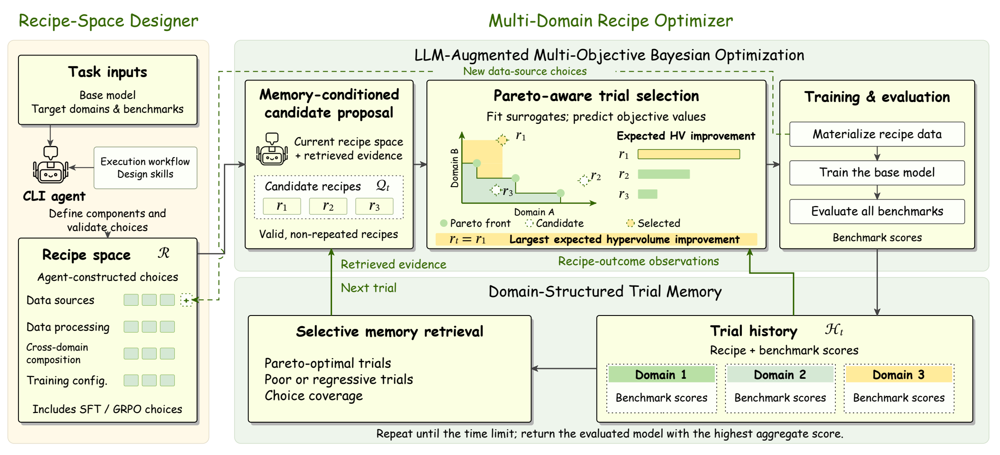

# SRO

### LLM Agents for Automated Post-Training via Structured Recipe Optimization

SRO is an agentic framework for automatically post-training language models across multiple capability domains under a fixed compute budget. It jointly optimizes coupled decisions over data sources, data processing, cross-domain composition, and training configuration.

Existing systems typically choose between two extremes: searching a predefined recipe space that cannot adapt to a new task, or using an open-ended agent whose useful discoveries remain implicit in individual trials. SRO bridges this gap by optimizing over a **task-adapted, explicit recipe space** whose choices can be reused, recombined, and evaluated systematically.

<p align="center">
  
</p>

SRO has two main components:

- **Recipe-Space Designer:** an LLM agent identifies and validates task-specific data sources, processing methods, cross-domain mixtures, and training choices.
- **Multi-Domain Recipe Optimizer:** structured trial memory guides LLM candidate construction and multi-objective Bayesian trial selection until the time budget is exhausted.

The implementation follows a complete `Discovery → Search → Evaluate` workflow.

## Paper

[LLM Agents for Automated Post-Training via Structured Recipe Optimization](https://arxiv.org/abs/2610.18572) · arXiv:2610.18572 | [PDF](https://arxiv.org/pdf/2610.18572)

## Installation

SRO requires Python 3.10+, Linux, CUDA, and one visible NVIDIA GPU for Search and Evaluate.

```bash
python3 -m venv .venv
source .venv/bin/activate
pip install '.[search]'
```

Create a local configuration file and provide the required model, agent, and evaluation credentials:

```bash
cp .env.example .env
```

## Quick Start

Run the complete workflow:

```bash
mdpt run \
  --task configs/tasks/six_benchmark.json \
  --env .env \
  --work-dir runs/example \
  --full \
  --max-hours 20 \
  --search-config configs/search/default.json
```

`--full` runs Discovery, Search, and final Evaluate. The time budget covers Discovery and Search; final evaluation runs afterward.

Each stage can also be run independently:

```bash
# Discovery
mdpt run \
  --task configs/tasks/six_benchmark.json \
  --env .env \
  --work-dir runs/example \
  --discovery

# Search
mdpt run \
  --env .env \
  --work-dir runs/example \
  --search \
  --max-hours 20 \
  --search-config configs/search/default.json

# Final evaluation
mdpt run \
  --env .env \
  --work-dir runs/example \
  --evaluate
```

## Outputs

```text
discovery/workspace/handoff/   Task-adapted recipe space
search/final_model/            Selected model
evaluate/metrics.json          Final evaluation results
```

## Acknowledgments

SRO uses benchmark formats and evaluation components derived from or aligned with [PostTrainBench](https://github.com/aisa-group/PostTrainBench). We also acknowledge [AutoTrainess](https://github.com/simple-agent-lab/AutoTrainess) as related work on skill-structured agents for autonomous language-model post-training. Individual benchmark evaluators retain their upstream attribution where applicable.

## Citation

If you find SRO useful in your research, please cite our paper:

```bibtex
@misc{liu2026llmagentsautomatedposttraining,
  title={LLM Agents for Automated Post-Training via Structured Recipe Optimization},
  author={Ruohong Liu and Bohan Tang and Lekang Jiang and Jack Umenberger and Yiwen Guo},
  year={2026},
  eprint={2610.18572},
  archivePrefix={arXiv},
  primaryClass={cs.AI},
  url={https://arxiv.org/abs/2610.18572},
}
```
